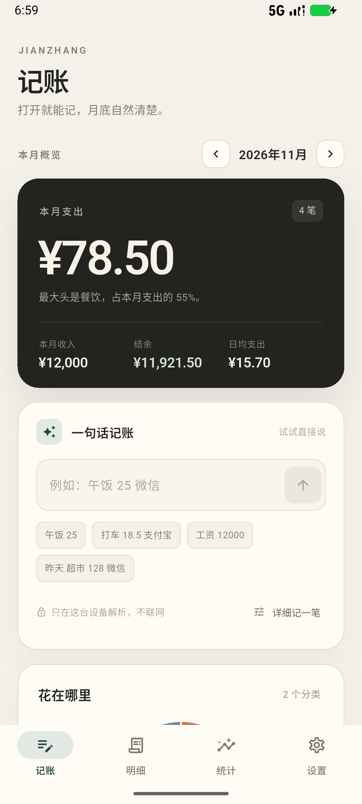

# 简账

本地优先的中文记账本。打开就能记，月底自然清楚。



## 功能

- **一句话记账**：输入「午饭 25 微信」「昨天打车 18.5 支付宝」「工资 12000」，自动解析金额、收支方向、分类、账户和日期。
- **官方账单导入**：支持微信支付、支付宝导出的 CSV / Excel（.xlsx）；自动识别表头和编码，按交易单号去重，导入前可预览。
- **明细与统计**：按月查看、按收支筛选、搜索商家/备注/分类/账户，左滑删除；统计页有分类占比和近 6 个月趋势。
- **本地优先**：SQLite 单文件账本，无账号、无云同步、无埋点；导入的原始文件只在内存解析，不保留副本。
- **响应式界面**：手机底部导航，Windows 宽屏侧栏。

## 运行

### Android

下载 [简账-1.1.0.apk](https://github.com/Sword-yidefuren/jianzhang/releases/download/v1.1.0/jianzhang-1.1.0.apk)。当前是 debug 签名，适合自用和测试，不上架应用商店。

### Windows

下载 [简账-1.1.0-windows.zip](https://github.com/Sword-yidefuren/jianzhang/releases/download/v1.1.0/jianzhang-1.1.0-windows.zip)，解压后运行 `jianzhang.exe`。整个目录一起使用，不要只拿 exe。

Windows 首次启动会在 `%APPDATA%\Sword\简账\jianzhang.sqlite` 建账本。如果该目录不可写，会自动退到 exe 同级的 `jianzhang-data\jianzhang.sqlite`，设置页会显示实际路径。

## 账单导入

1. 微信：我 → 服务 → 钱包 → 账单 → 常见问题 → 下载账单 → 用于个人对账；账单是加密 ZIP，先用邮件里的解压码解压。
2. 支付宝：我的 → 账单 → 右上角更多 → 开具交易流水证明；或在电脑端下载余额收支明细。
3. 得到 CSV 或 .xlsx 后，在「设置 → 导入微信 / 支付宝账单」选择文件，确认预览，再导入。

不要直接把微信的加密 ZIP 拖进来；App 只接收解压后的 CSV、TXT 或 .xlsx。旧版二进制 `.xls` 不支持，请在 Excel/WPS 里另存为 `.xlsx` 或 CSV。

## 数据

- 金额一律以整数分存储，避免浮点误差。
- Android：`/data/user/0/com.sword.jianzhang/files/jianzhang.sqlite`
- Windows：`%APPDATA%\Sword\简账\jianzhang.sqlite`，或便携回退路径
- 设置页可导出 CSV（带 BOM，Excel 直接打开），也可清空全部账目。

## 边界

- **不做实时同步**。微信/支付宝没有开放个人账单实时接口，当前只做官方导出文件（CSV / Excel）导入和手动一句话记账。
- 不做无障碍点击、通知监听、后台抓取。
- 分类是离线关键词规则，导入后可在明细里改分类或删除。

## 开发

```bash
flutter pub get
flutter test
dart analyze --fatal-infos
flutter run
```

构建：

```bash
flutter build apk --release
flutter build windows --release
```

### 本机构建注意

1. Windows 构建必须放在 **纯 ASCII 路径**。中文路径会触发 CMake/MSBuild 的 `Unable to read file ... app.dill`。
2. `package:sqlite3` 默认从 GitHub 下载预编译库；当前网络下会失败。项目已内置 SQLite 3.54.1 amalgamation：
   ```yaml
   hooks:
     user_defines:
       sqlite3:
         source: source
         path: third_party/sqlite3/sqlite3.c
   ```
   不要删除这段配置。
3. Windows 窗口标题在 `windows/runner/main.cpp` 里用 Unicode 转义 `L"\u7B80\u8D26"`，不要改回中文字面量，否则 MSVC 代码页报错。
4. 图标由 `python tools/generate_icon.py` 生成，依赖 Pillow 和微软雅黑字体。

## 目录

- `lib/domain/`：一句话解析、分类、账单导入
- `lib/data/`：SQLite 存储与数据模型
- `lib/state/`：页面共享状态
- `lib/ui/`：主题、页面、组件、编辑面板
- `docs/可行性说明.md`：为什么不做实时同步
- `docs/产品与交互.md`：信息架构、字段映射、验收标准
- `docs/验收清单.md`：本轮实际验证结果
