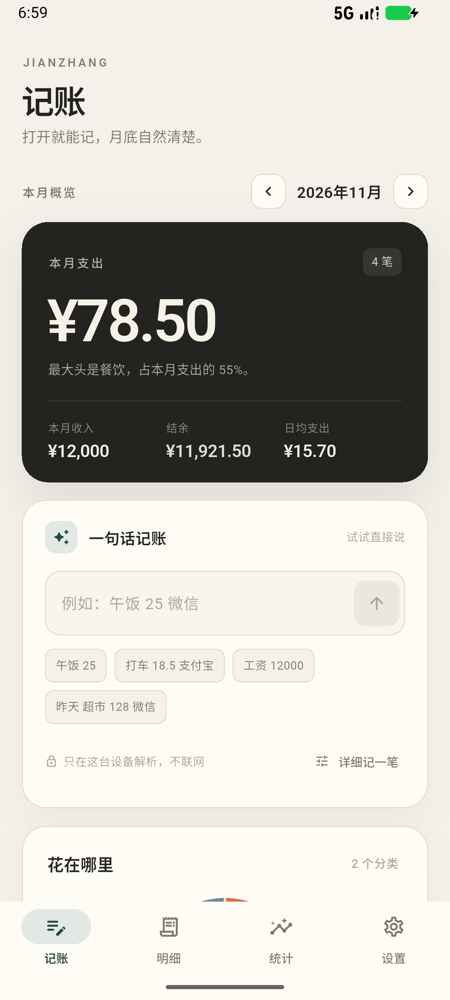
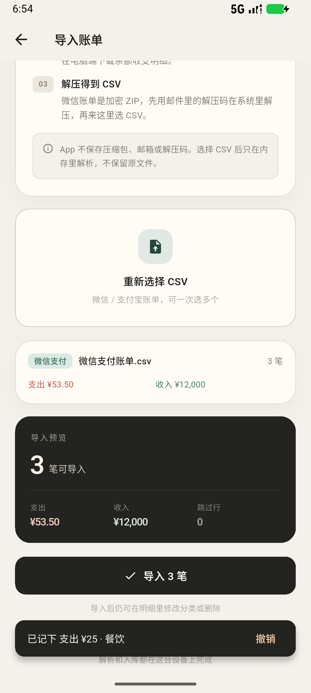
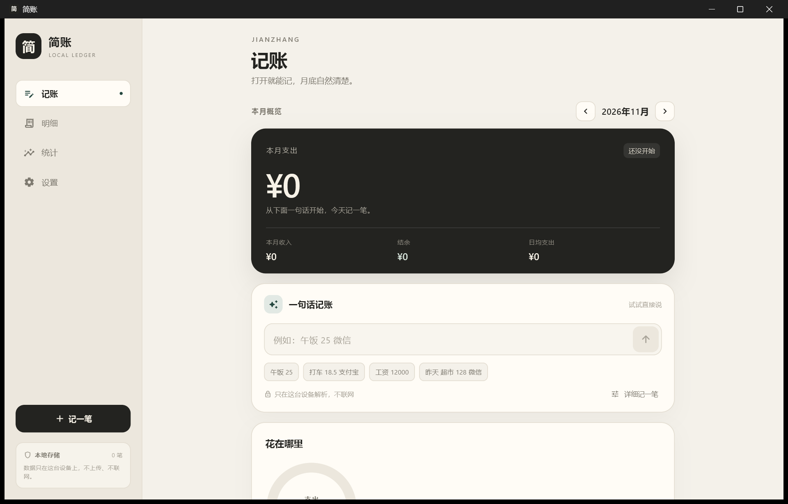

# 验收清单

记录 2026-11-06 的实际验证结果，不把“应该能用”写成“已经验证”。

## 自动化

| 项目 | 结果 |
| --- | --- |
| `flutter test` | 33 项全部通过 |
| `dart analyze --fatal-infos` | No issues found |
| 一句话解析 | 金额、收支、日期、时间、账户、全角数字、多人 AA 跳过人数等用例通过 |
| 账单导入 | 微信用例、支付宝 UTF-8/GBK、表头定位、不计收支跳过、交易单号稳定 |
| Excel 导入 | 微信/支付宝 XLSX、共享字符串、内联字符串、Excel 日期序列、openpyxl 真实工作簿 |
| SQLite | 插入、月度汇总、分类统计、重复导入去重 |
| 响应式 UI | 1280×820 和 430×900 四个页面切换无溢出 |
| 一句话入账 | 输入到保存、首页金额和笔数即时更新、撤销条 4 秒后自动消失 |
| 详细记账面板 | 手机端打开、字段渲染、关闭无异常 |

## Android 模拟器

设备：`Medium_Phone`，Android 37.2 beta3，1080×2400。

- [x] release APK 安装成功
- [x] 冷启动进入首页，无启动错误
- [x] 一句话示例「午饭 25」保存为支出/餐饮/微信
- [x] 保存后首页支出、笔数、日均、分类即时更新（修复了页面实例缓存导致的旧数据）
- [x] 记账、明细、统计、设置四个 Tab 正常切换
- [x] 明细页按日分组、收支筛选、搜索框正常渲染
- [x] 左滑删除，确认弹窗，删除后列表变为 1 笔
- [x] 选择 CSV 文件：系统文档选择器可打开
- [x] 选择 .xlsx 文件：系统选择器显示为 XLSX spreadsheet，导入预览 3 笔、支出 ¥53.50、收入 ¥200
- [x] 完成 Excel 导入后新增 3 笔，切到 2026 年 10 月可看到肯德基、公司工资、滴滴出行
- [x] 导入 3 行微信示例账单：预览显示支出 ¥53.50、收入 ¥12,000、跳过 0 行
- [x] 导入完成新增 3 笔，数据库落盘
- [x] 杀进程重开后 4 笔数据仍在，金额 ¥78.50 / ¥12,000 / 结余 ¥11,921.50
- [x] 设置页显示实际数据库路径 `/data/user/0/com.sword.jianzhang/files/jianzhang.sqlite`
- [x] 导出 CSV 会打开系统保存对话框，默认文件名 `简账-2026-11-05.csv`
- [x] 撤销条自动消失

截图：

## Windows

设备：Windows 11，窗口逻辑尺寸 1280×820，150% 缩放（截图像素 1920×1230）。

- [x] release 构建成功
- [x] 全尺寸窗口截图正常，侧栏、首页、一句话输入、分类区都在首屏内
- [x] 窗口标题、任务栏名称、应用图标为「简账」
- [x] 生产包启动成功（无 demo 数据、无数据库路径覆盖）
- [x] 受限环境下自动回退到 exe 同级 `jianzhang-data\jianzhang.sqlite`，设置页可看到路径
- [x] 首页在 1280×820 下无溢出
- [x] 四个页面在桌面尺寸的 widget 测试中无溢出

## 未验证 / 已知限制

- **没有用真实微信/支付宝导出文件跑过**，只用与官方表头一致的合成 CSV，以及 openpyxl 生成的真实 XLSX 工作簿。真实文件可能多几列、带说明行、GBK 变体或把账单放在第二个 sheet，导入器已有容错但需要一次真账验证。
- Windows 的**真实 `%APPDATA%` 写入**在当前 DSH 沙箱里被拦截，生产包走的是便携回退路径；普通桌面启动应写入 `%APPDATA%\Sword\简账`，但这一点没有在非沙箱环境实测。
- Windows 的明细/统计/设置页只做了 widget 测试和首页截图，没有逐页点击截图（窗口点击工具在计划任务进程上未成功聚焦）。
- APK 使用 debug 签名，未做 release keystore、混淆、上架包。
- 没有应用内备份/恢复；目前靠导出 CSV 和直接拷贝 SQLite 文件。
- 没有做无障碍自动化、通知监听或实时同步，这是明确的范围外。
